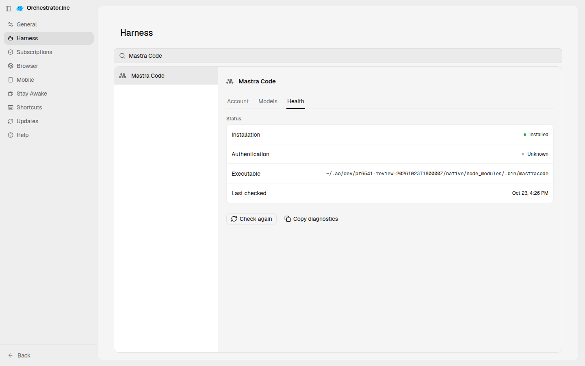
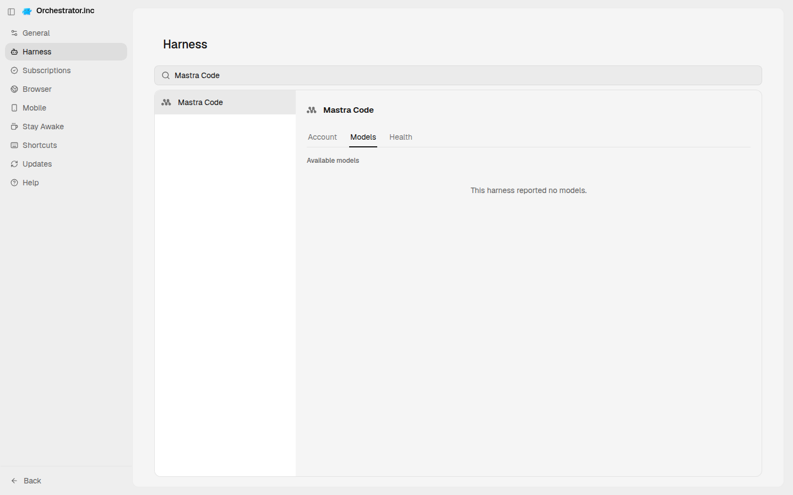
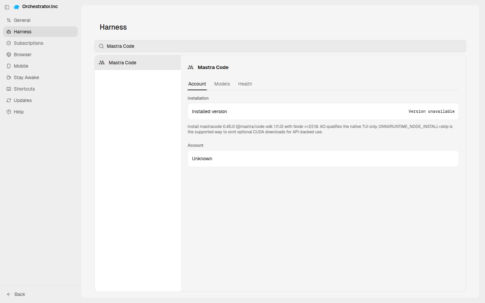
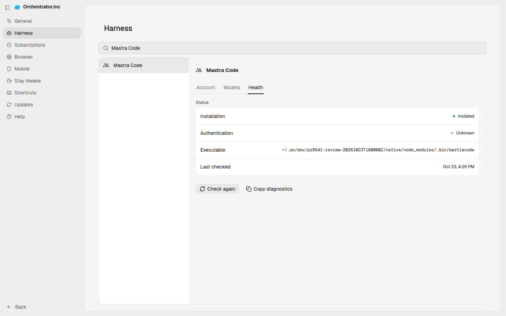
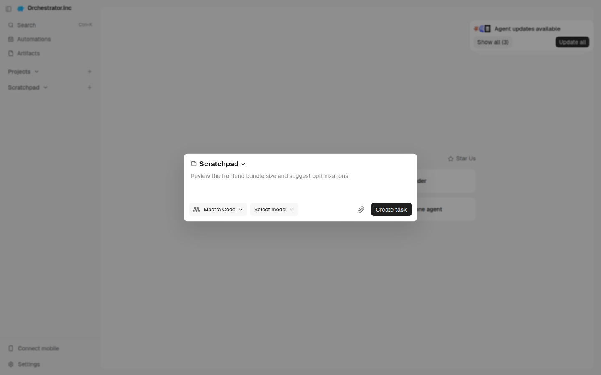
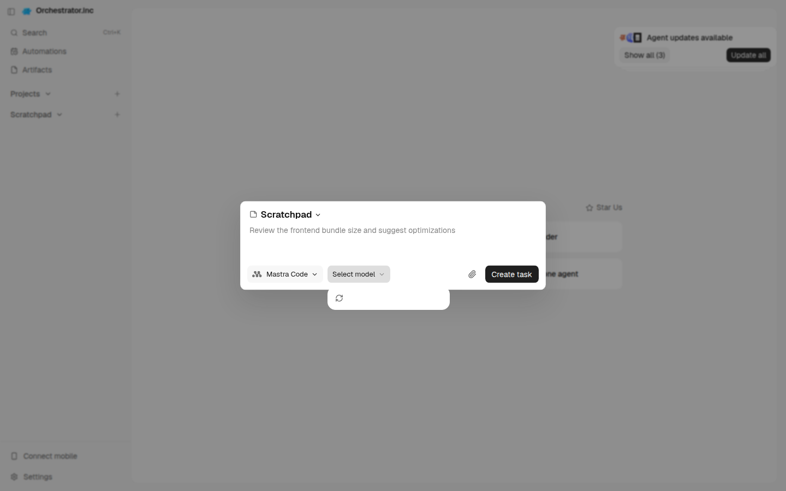

# AO UI audit: Mastra Code

| # | Checkpoint | Result | Reason | Screenshot |
|---|---|---|---|---|
| 1 | Agent Harness page lists the harness | PASS | listed as "Mastra Code"; detail view opened |  |
| 2 | Install from the Account tab | PASS | already installed; the Install action was not exercised |  |
| 3 | Health tab shows status, authentication and executable | PASS | health shows Authentication, Executable, Last checked |  |
| 4 | Models tab lists the harness models | FAIL | Models tab says: "reported no models" |  |
| 5 | Login or configure is offered (or already connected) | FAIL | not connected and no Login/Set up button |  |
| 6 | Auth check: Health says Connected | NEEDS_USER | not authenticated: log in or provide the API key, then rerun |  |
| 7 | Update the harness | NOT_RUN | skipped in v0 |  |
| 8 | New Task lists the agent (tui) | PASS | "Mastra Code" selectable in New Task |  |
| 9 | New Task lists the harness models (tui) | FAIL | Model picker opened with no models |  |
