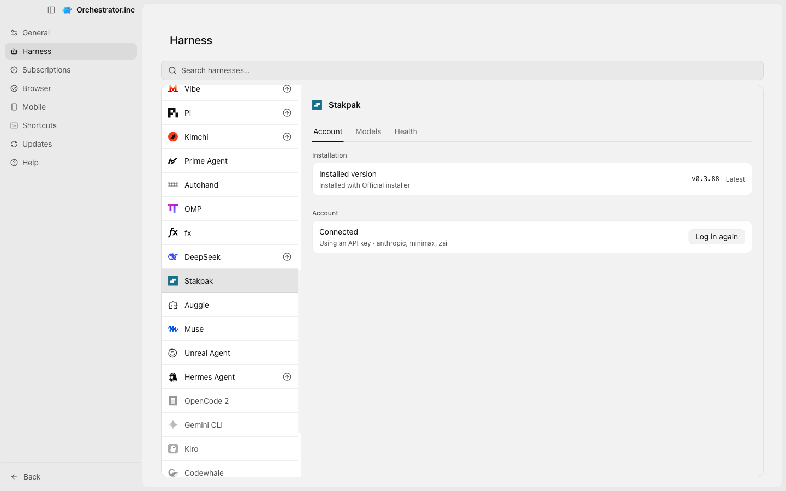
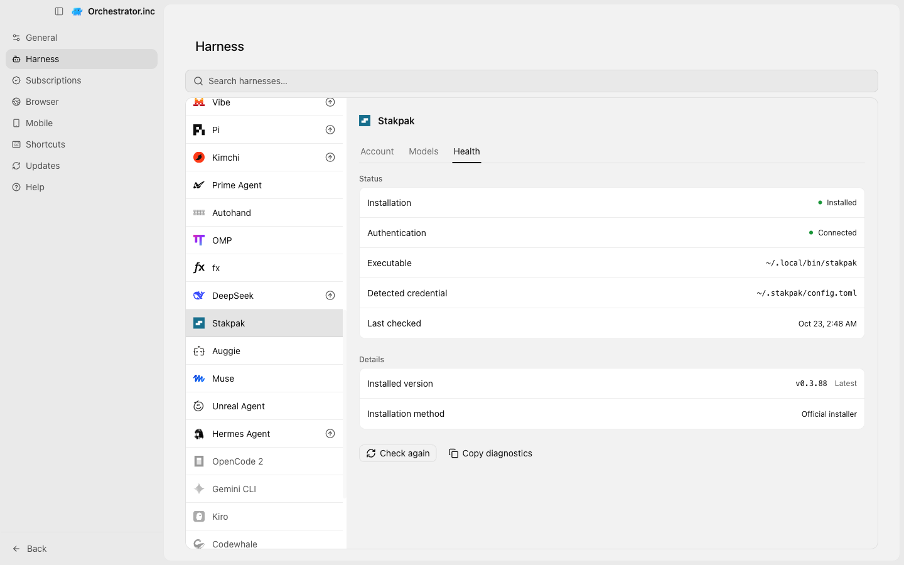
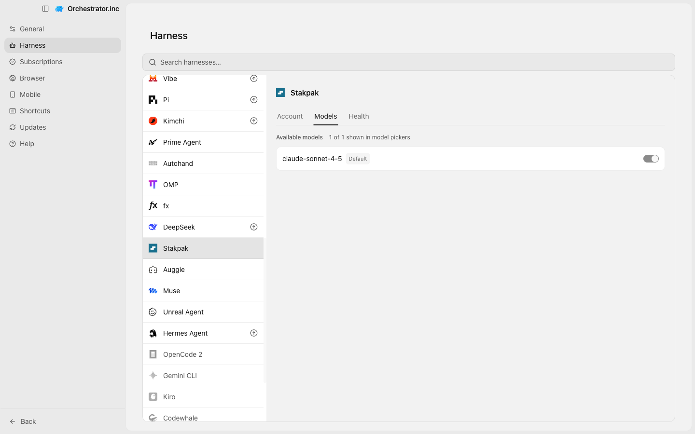
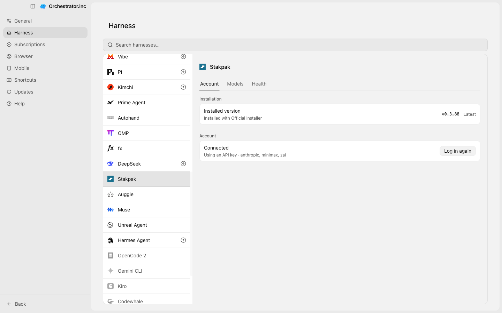
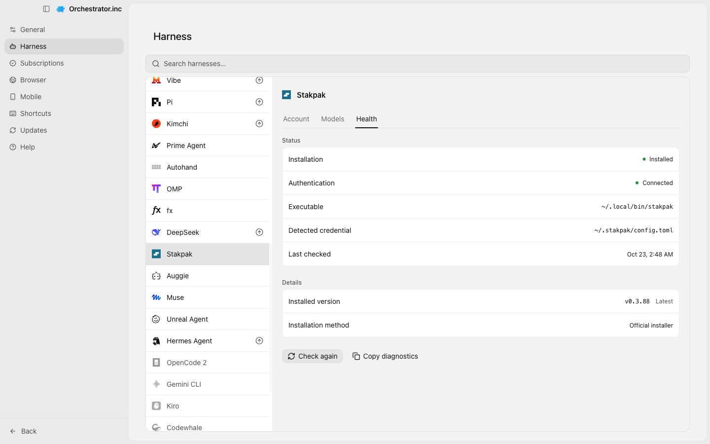
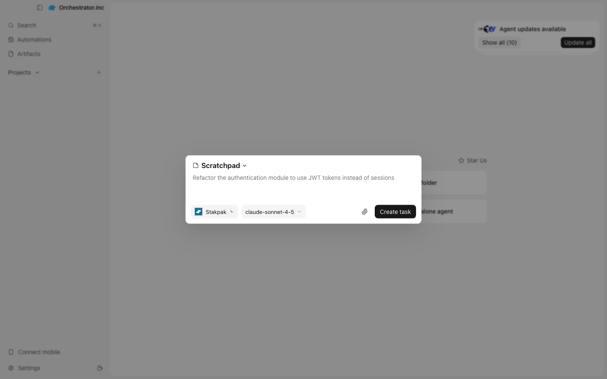
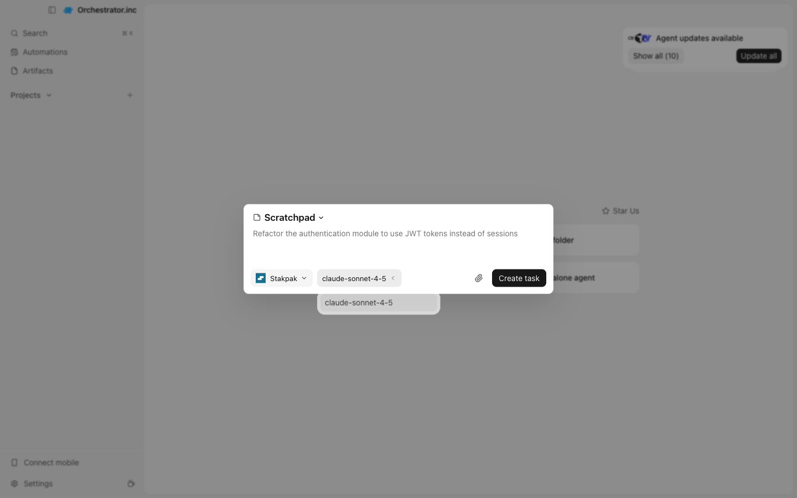
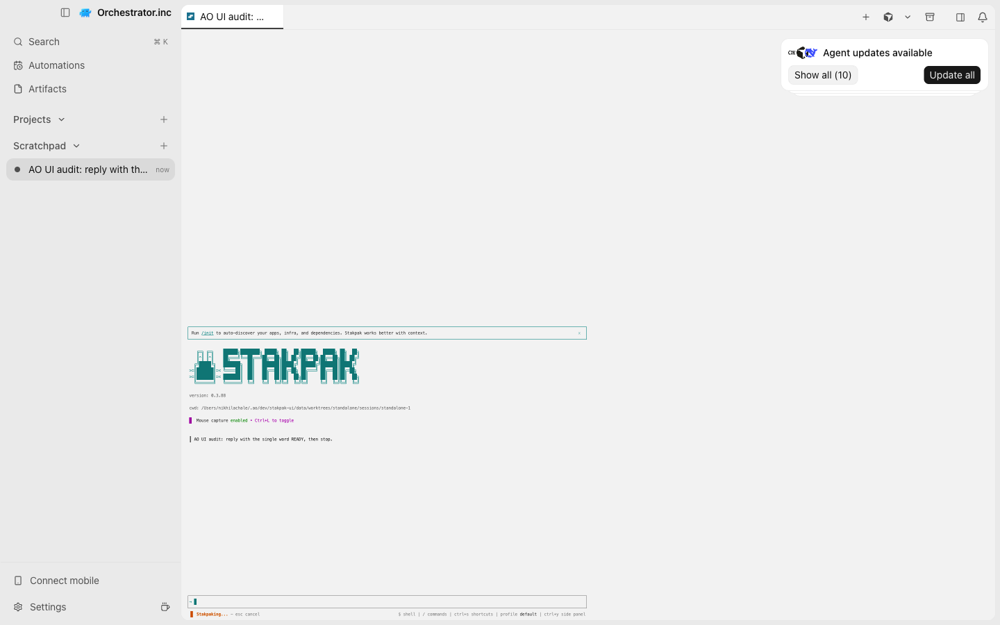

# AO UI audit: Stakpak

| # | Checkpoint | Result | Reason | Screenshot |
|---|---|---|---|---|
| 1 | Agent Harness page lists the harness | PASS | listed as "Stakpak"; detail view opened |  |
| 2 | Install from the Account tab | PASS | already installed; the Install action was not exercised |  |
| 3 | Health tab shows status, authentication and executable | PASS | health shows Authentication, Executable, Last checked |  |
| 4 | Models tab lists the harness models | PASS | 1 model(s) on this page; 1 of 1 shown in model pickers |  |
| 5 | Login or configure is offered (or already connected) | PASS | connected; Refresh login is offered |  |
| 6 | Auth check: Health says Connected | PASS | authentication verified: Connected |  |
| 7 | Update the harness | NOT_RUN | skipped in v0 |  |
| 8 | New Task lists the agent (tui) | PASS | "Stakpak" selectable in New Task |  |
| 9 | New Task lists the harness models (tui) | PASS | 1 model option(s), e.g. claude-sonnet-4-5 |  |
| 10 | Spawned agent runs in the terminal (TUI) | PASS | terminal session is running; its text is not readable from the page (WebGL renderer), see the screenshot |  |

Dismissed first-run dialogs (deferred, nothing chosen): Import projects from your earlier AO? → Skip
