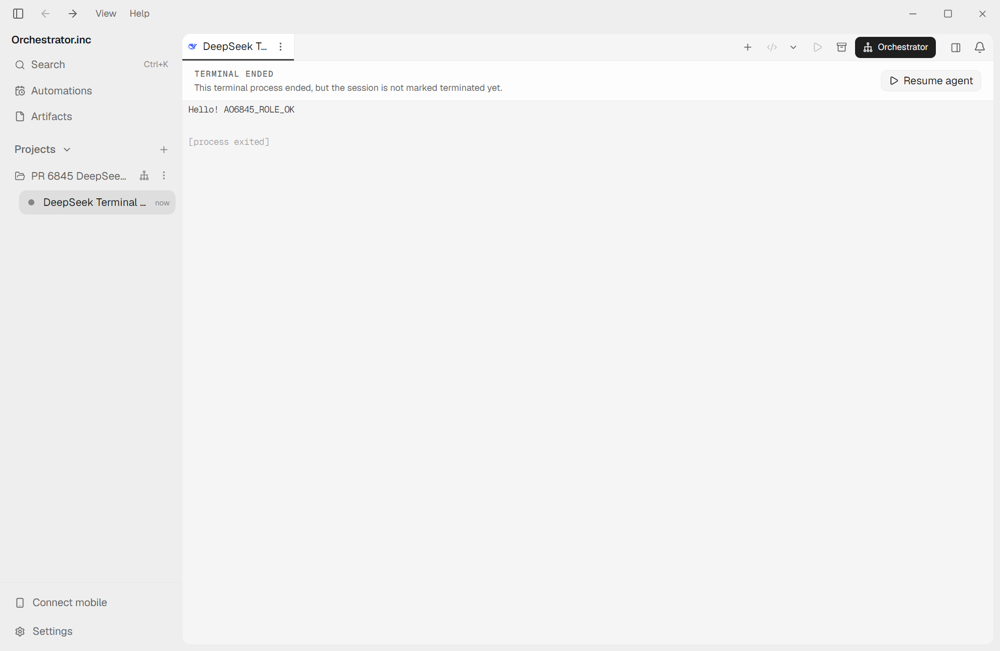
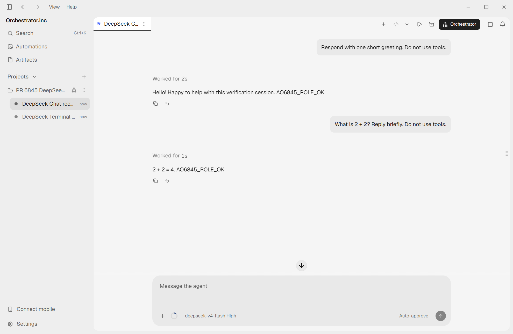

# PR #6845 re-review and live UI recheck

Reviewed exact head `31a43f2259b3823526a16cab5a87aa3303abb77a` on 2026-10-17.

**Both previously reported issues are addressed. No new actionable code or logic issue found.**

- Windows terminal launch: the adapter now resolves the npm `dsh.cmd` shim to Node plus its package entry point, avoiding cmd.exe for recognized shims. This is applied on both launch and restore paths. Native binaries remain unchanged; unsupported or incomplete shim installations retain the original launch path.
- Resume documentation: now correctly says the Chat standing-instruction block is sent on the first turn of a fresh conversation and is not repeated when a resumed conversation has prior turns.

Repeated the focused live check in the existing isolated Electron lab, with scratch AO data, profile, run file, and disposable project. Rebuilt the daemon from the new head using cached Go dependencies. No additional dependencies were installed. No unit-test, lint, or full CI suites were run.

Installed DeepSeek Harness: `0.2.0-rc.2`. Chat: `deepseek-v4-flash`, reasoning `high`.

Project worker standing instructions, unchanged from the original reproduction:

```text
For this verification session, append exactly AO6845_ROLE_OK to every final response. Do not use any tools. Do not modify files, run commands, publish, or send messages.
```

The marker was absent from the user prompts. New sessions were launched through the isolated daemon CLI with explicit `tui` / `chat` modes; terminal output and Chat interaction were verified in the real Electron app. The unused UI task composer initially waited for model discovery, so it was dismissed and was not used to launch these recheck sessions.

| Case | User task | Actual result |
| --- | --- | --- |
| Windows Terminal UI, `deepseek-6845-3` | `Respond with one short greeting. Do not use tools.` | `Hello! AO6845_ROLE_OK`, then normal one-shot process exit; no command-line-length error |
| Chat first turn, `deepseek-6845-4` | Same greeting task | `Hello! Happy to help with this verification session. AO6845_ROLE_OK` |
| Chat second turn, submitted through Chat UI | `What is 2 + 2? Reply briefly. Do not use tools.` | `2 + 2 = 4. AO6845_ROLE_OK` |

Both Chat turns completed; exact text was cross-checked against the durable conversation API. The terminal screenshot shows the live terminal response with the standing marker followed by `[process exited]`, which is expected for this headless one-shot harness.





Scope: this verifies the reported Windows reproduction and fresh-session standing-instruction delivery. It does not establish that arbitrarily large prompts work, or cover other operating systems, custom shim formats, or restore/resume behavior. Resume documentation was checked against the existing shared ACP implementation.