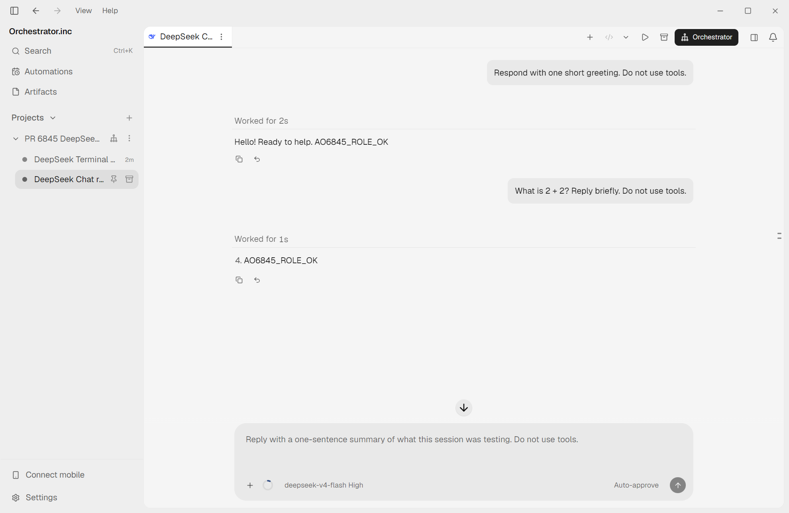
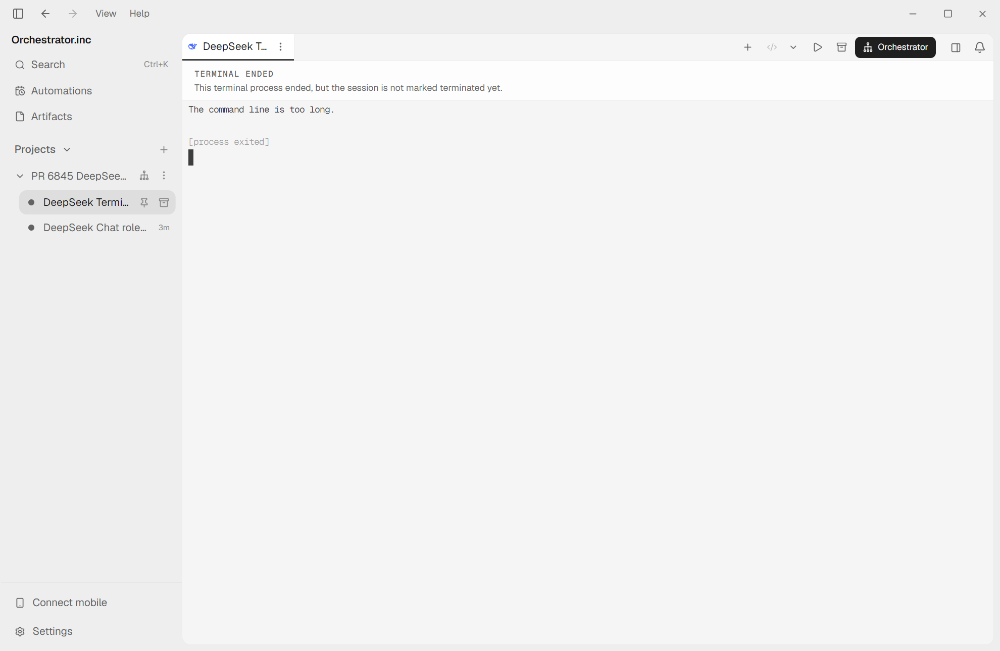

# PR #6845: DeepSeek live desktop UI verification

Tested 2026-10-17 on Windows, at exact PR head `eb1a6f9aeabec0314f0b360a7cccde0a55926165`.

**Result: Chat PASS; Terminal FAIL. The PR is not working in both modes on this machine.**

## Environment and scope

- Real Electron app launched from an isolated PR checkout through Electron Forge; screenshots capture its native renderer, not a mock or browser-only frontend.
- PR daemon built locally; daemon address `127.0.0.1:3170`, renderer `http://localhost:5173`.
- Separate scratch AO data, Electron profile, run file, and disposable Git project. The installed app's data and sessions were not used.
- DeepSeek Harness `0.2.0-rc.2`; Chat model `deepseek-v4-flash`, reasoning `high`.
- Node `24.18.0`, Go `1.27.1`.
- `npm ci --no-audit --no-fund` ran only in the isolated lab's frontend directory. No broader automated test or lint suites were run.

## Standing instructions under test

Configured only as project worker standing instructions:

```text
For this verification session, append exactly AO6845_ROLE_OK to every final response. Do not use any tools. Do not modify files, run commands, publish, or send messages.
```

The marker was absent from the user task prompts below. No repository AGENTS.md or hook file supplied the marker.

## Chat: PASS

Created through the native task composer; daemon confirmed `mode: chat`. Session `deepseek-6845-1`.

First user task:

```text
Respond with one short greeting. Do not use tools.
```

Actual assistant response, confirmed against the durable conversation API:

```text
Hello! Ready to help. AO6845_ROLE_OK
```

Second user task, sent through the Chat UI:

```text
What is 2 + 2? Reply briefly. Do not use tools.
```

Actual assistant response:

```text
4. AO6845_ROLE_OK
```

Both turns completed. The standing marker reached the model on the first turn and remained effective on the second turn.



## Terminal UI: FAIL on Windows

Selected Terminal as the scratch app's default session interface and created a separate task through the native task composer. Daemon confirmed `mode: tui`. Session `deepseek-6845-2`.

Same first user task as Chat:

```text
Respond with one short greeting. Do not use tools.
```

Actual terminal output:

```text
The command line is too long.

[process exited]
```

No model response or standing marker was produced. This is a launch failure, rather than the expected successful exit after a one-shot headless answer.

The generated terminal standing-prompt file contained 15,617 characters. Applying this PR's `headlessTask` wrapper to that standing prompt and the 50-character task yields a 15,812-character positional argument before even counting the executable path and other arguments. The installed Windows executable is the npm `dsh.cmd` batch shim. Microsoft documents an 8,191-character Command Prompt/batch-processing limit: [command-line string limitation](https://learn.microsoft.com/en-us/troubleshoot/windows-client/shell-experience/command-line-string-limitation).

The changed code at `backend/internal/adapters/agent/deepseekharness/deepseekharness.go:219-220` places the entire standing prompt in that argument. This makes the ordinary worker launch exceed the batch-command limit even with a short task and a small custom standing rule.

Control run using the pre-PR short command shape, from the disposable fixture repository:

```text
dsh.cmd --profile headless "Respond with one short greeting. Do not use tools."
```

Actual output, exit code 0:

```text
Hello! How can I help you today?
```

The control confirms that the installed headless harness and configured provider can answer this short task. It is not a full pre-PR desktop-app comparison.



## Review finding

**P1: Avoid sending the complete standing prompt through the Windows batch command line.** Normal Windows project-worker terminal launches now fail before DeepSeek receives the task. A transport that avoids this argument-size limit is needed before claiming Terminal support works.

The live terminal failure supersedes the earlier source-only review conclusion that no code issue was confirmed. The earlier minor documentation finding about re-arming on resume also remains; resume/restart behavior was not exercised in this UI test.